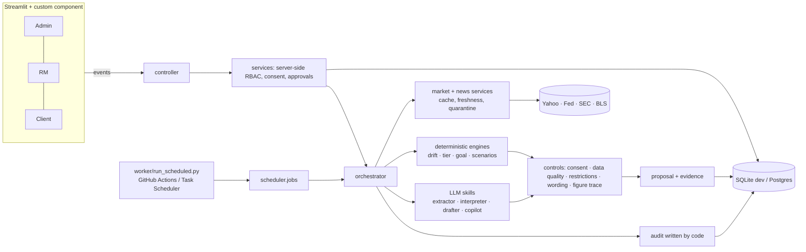

# Atlas Wealth Management: Dynamic Wealth Navigator (DWN)

A working **case-study prototype** of an AI-assisted monitoring and drafting agent for relationship managers (RMs). It watches client portfolios against each client's plan, decides which clients need attention and why, and puts an explained, evidence-backed draft in front of the RM. **The RM decides. Nothing is ever executed, traded or sent.**

> **Prototype with synthetic data.** Not enterprise-production-ready, not financial advice, not a regulatory-compliance claim. Read [docs/SECURITY.md](docs/SECURITY.md) and the limitations below.

## What it does
- **Three separate workspaces** (Admin, RM, Client) in the exact visual design supplied in `reference/atlas_rm_workbench_original.html`, built as a Streamlit app.
- **Real market and news data:** prices from Yahoo Finance (unofficial), official headlines from the Federal Reserve, SEC and BLS, each with source link, timestamps and a freshness label. A failed fetch shows *unavailable*, never invented numbers.
- **A multi-step agent:** deterministic engines compute every number (drift, five-factor tier, goal outlook, scenarios); controls check consent, data quality, restrictions, wording and figure traceability; optional LLM skills (Groq/Gemini) only interpret and draft, and fall back to deterministic templates.
- **Human approval:** Tier 1 digest; Tier 2 RM decides; Tier 3 needs a client conversation and a *different* senior second approver.
- **Consent** (versioned, withdrawable), **append-only audit trail**, **persistent database**, **scheduler** that really executes (worker + run history).
- **345 automated tests**, a 36-scenario golden data set, a mutation check of 27 safety controls, and a page-by-page parity comparison against the original HTML.

## Quick start (local, Windows PowerShell)
```powershell
python -m venv .venv
.\.venv\Scripts\Activate.ps1
pip install -r requirements-dev.txt
python -m pytest tests -q                      # 345 tests, about 20 seconds
python -m streamlit run app.py                 # opens http://localhost:8501
```
Demo sign-ins (local demo only; password `atlas-demo`): `admin@atlas-demo.com`, `priya.sharma@atlas-demo.com` (RM with 24 clients), `arjun.mehta@atlas-demo.com` (senior RM), `ramesh.agarwal@atlas-demo.com` (client). Every client signs in as `first.last@atlas-demo.com`. The first start creates `data/dwn.sqlite3` automatically.

Run the agent yourself:
```powershell
python scripts\run_golden_agent.py             # all 36 golden scenarios through the real orchestrator
python scripts\run_live_agent.py               # real prices + news, then the agent on 6 clients
python worker\run_scheduled.py --once          # execute any due schedules
```
Full deployment (GitHub, Supabase, Streamlit Community Cloud, scheduler, API keys): **[docs/DEPLOYMENT.md](docs/DEPLOYMENT.md)**.

## Architecture

More diagrams (agent workflow, approval state machine, data model): [docs/ARCHITECTURE.md](docs/ARCHITECTURE.md).

## Project layout
| Path | Purpose |
|---|---|
| `app.py` | Streamlit entry point (one DB transaction per UI event) |
| `ui_component/` | The original CSS (verbatim) and a thin browser shell; **no auth or data logic in the browser** |
| `dwn/ui/` | `render.py` (HTML from your design), `controller.py` (events → services) |
| `dwn/services.py`, `dwn/auth.py`, `dwn/security.py` | Authorisation, consent, approvals, passwords |
| `dwn/engines/`, `dwn/controls/` | Deterministic calculations and safety controls |
| `dwn/agents/` | Orchestrator, LLM adapters, the four skills, proposal schema |
| `dwn/data/` | Market + news providers, hardened HTTP client, freshness |
| `dwn/scheduler/`, `worker/` | Job runner and the worker entry point |
| `dwn/db/`, `alembic/`, `dwn/repo.py` | Models, migrations (0001-0004), data access |
| `golden/` | 36-scenario golden data set (xlsx + json) and its builder/reference checker |
| `tests/` | 345 tests |
| `scripts/` | Golden run, live run, mutation check, UI parity, live smoke |
| `docs/` | Deployment, architecture, security, per-phase build log, parity screenshots |

## External services
| Service | Used for | Key? | Required? |
|---|---|---|---|
| Yahoo Finance chart endpoint | prices (unofficial, no SLA) | none | yes for live prices |
| Federal Reserve, SEC, BLS RSS | official news | none | yes for live news |
| Postgres (e.g. Supabase) | hosted persistence | connection string | yes when hosted (SQLite is local only) |
| GitHub (+ Actions) | source control, scheduler clock, CI | account | yes for hosted scheduling |
| Streamlit Community Cloud | hosting | account | optional |
| Groq / Google Gemini | LLM drafting and interpretation | API key | optional (default: no AI) |
| Alpha Vantage | fallback prices | free API key | optional |

## Latest changes (fix batch)
Whole-page scrolling, no grey overlay while the server works, about 3x fewer database queries per page, overview numbers that match the queue (and are clickable), AI Insights with real current-vs-proposed allocation and working Review buttons, a rebuilt Reports page (view and download, all clients), **Run now** (per client, all clients, scheduler) running in the background, client dashboards with charts, client to RM secure chat plus an RM Messages page, and Groq switched on simply by adding `GROQ_API_KEY`. See [docs/DEPLOYMENT.md](docs/DEPLOYMENT.md) section 6b.

## Honest limitations
- **Synthetic data only.** Goal numbers for the 24 prototype clients are generated placeholders. Thresholds, assumptions and wording rules are placeholders for compliance to set.
- **No LLM has been run live** (no key was available); the adapters are tested against fake transports only. Add `GROQ_API_KEY` to try it.
- Performance charts are **estimates from market proxies**, not actual account returns (no real return history exists in this prototype).
- Verified on **SQLite** (Python 3.14 and 3.12) and on a **local PostgreSQL 17** (343 tests plus a prod-mode smoke test, see `docs/08_phase8_verification.md`). **Supabase, Streamlit Community Cloud and GitHub Actions have not been run.**
- Yahoo Finance is an unofficial source; do not treat it as licensed market data.
- Own password authentication only (no MFA, no email verification).
- Details: [docs/SECURITY.md](docs/SECURITY.md).

## Build log
`docs/01…08` document each phase: discovery and traceability, UI parity, backend, market data, the agent, the scheduler, hardening, and deployment/verification.
