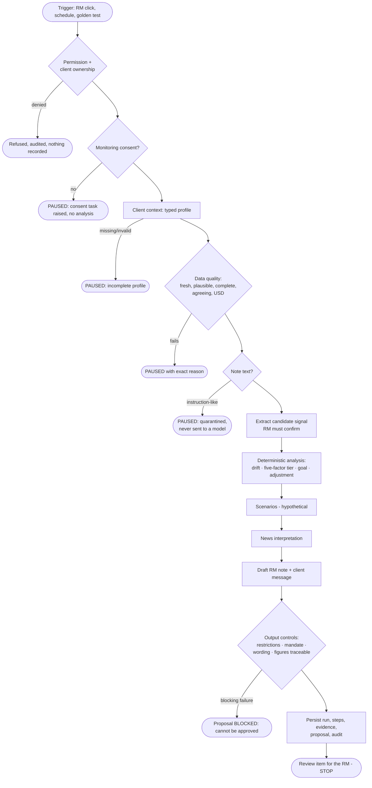
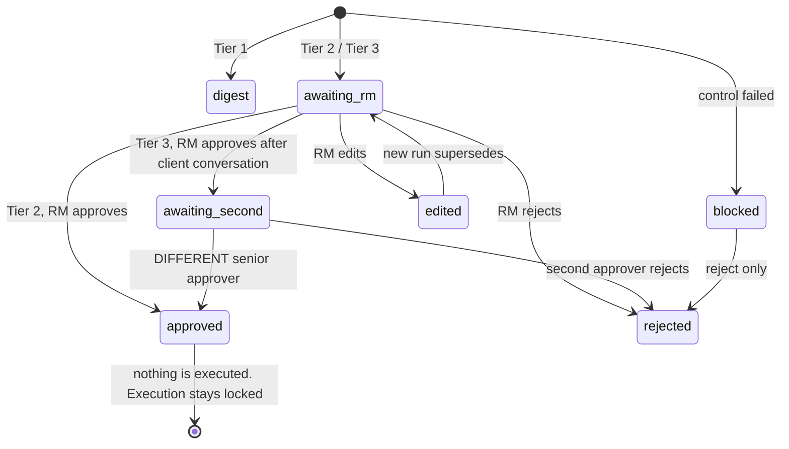
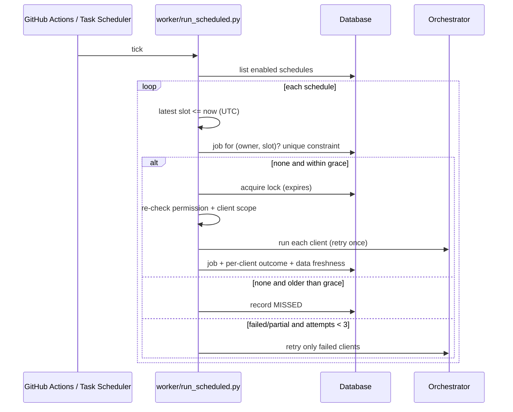

# Architecture

## 1. Layers
Principle from the concept document: **AI drafts and explains, engines calculate, authorised people decide.**

| Layer | Code | Rule |
|---|---|---|
| UI | `ui_component/`, `dwn/ui/` | Renders HTML for the signed-in role only; sends actions to the server. No auth, no client data logic in the browser. |
| Authorisation + consent | `dwn/services.py`, `dwn/auth.py` | Every action re-checks role, client ownership, consent, scheduling permission. |
| Orchestration | `dwn/agents/orchestrator.py` | One explicit typed run; stops at "awaiting human". No approval or execution code. |
| Deterministic engines | `dwn/engines/` | Same input → same output. All numbers come from here. |
| Controls | `dwn/controls/`, `orchestrator._controls` | Gates (consent, data quality, injection), policy flags, wording, figure traceability. |
| Data ingestion | `dwn/data/` | Hardened HTTP, provenance, freshness, quarantine of untrusted text. |
| LLM skills | `dwn/agents/skills.py`, `llm.py` | Interpret and draft only; validated, grounded, replaceable by deterministic fallbacks. |
| Persistence + audit | `dwn/repo.py`, `dwn/db/` | One transaction per event; audit is append-only (DB triggers). |
| Scheduling | `dwn/scheduler/`, `worker/` | At-most-once per slot, locks, permission re-check at run time. |

## 2. One monitoring run

## 3. Approval state machine (humans only)

## 4. Scheduler

## 5. Data model (main tables)
`users · rms · rm_permissions · clients · client_profiles · goals · holdings · transactions · consents · audit_events (append-only) · recommendations · proposals · approvals · agent_runs · run_steps · evidence_items · adviser_notes · client_message_drafts · schedules · schedule_runs · job_runs · job_run_items · job_locks · data_sources · market_quotes · news_items · policy_settings`. Migrations: `alembic/versions/0001…0004`.

## 6. Mapping to the 10 agents in the build prompt
See the table in [docs/05_phase5_agent.md](05_phase5_agent.md): most "agents" are deterministic services on purpose; only four skills use a language model.
